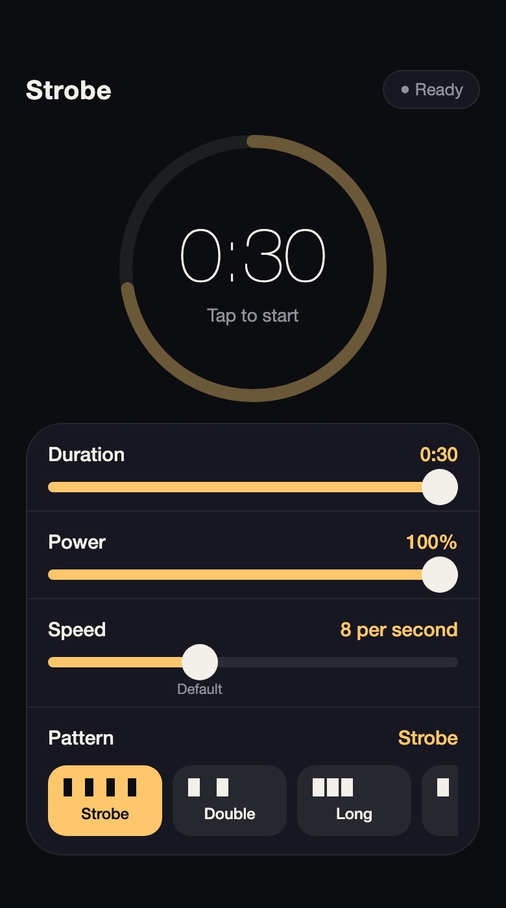

# FlashTimer

An iPhone app that strobes the flashlight for a set amount of time. You choose how long, how bright, how fast and in what pattern. Dark UI with an amber accent.



## Features

- **Duration:** 1 to 30 seconds, with a haptic tick on every step.
- **Power:** 5% to 100% torch brightness, adjustable while it runs.
- **Speed:** 1 to 20 flashes per second, adjustable while it runs. Each pattern has a default speed that the slider snaps to.
- **Patterns:** Strobe, Double, Triple, Long blink and SOS. You can also create, edit and delete your own step patterns.
- Starts and stops with one tap. Stop turns the torch off immediately.

## Install on your iPhone (free, no developer account)

You need an iPhone on iOS 17 or later, a Mac or Windows PC, and a free Apple ID.

1. Download [`FlashTimer.ipa`](FlashTimer.ipa) from this repo.
2. Install [Sideloadly](https://sideloadly.io) and plug in your iPhone.
3. Drag `FlashTimer.ipa` onto Sideloadly, enter your Apple ID and press Start.
4. On the iPhone open Settings, General, VPN & Device Management, tap your Apple ID and choose Trust.
5. If iOS asks, turn on Developer Mode in Settings, Privacy & Security. The phone restarts.
6. Open FlashTimer from the home screen.

Apps signed with a free Apple ID expire after 7 days. Repeat the steps to renew. If Sideloadly says the bundle ID is taken, change `com.example.flashtimer` to something unique in Advanced Options.

## Build from source

You need Xcode installed.

```bash
./build.sh
```

This compiles `FlashTimer.swift` for iPhone and writes an unsigned `FlashTimer.ipa`, which Sideloadly then signs.

## Good to know

- The torch only works while the app is open on screen. Locking the phone or switching apps turns it off.
- iOS lowers the torch brightness when the phone gets hot. The app cannot override that.
- Very fast strobing can look uneven because the phone's LED has limits.
- Rapid flashing can trigger seizures in people with photosensitive epilepsy.

## License

[MIT](LICENSE)
